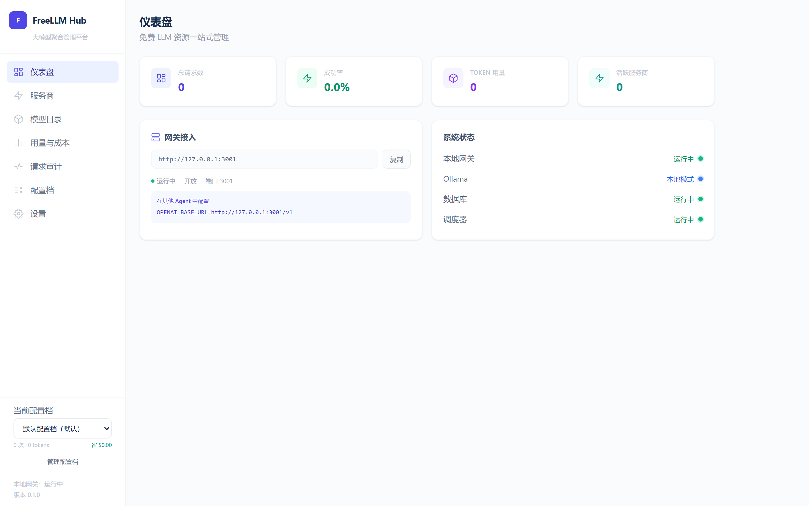
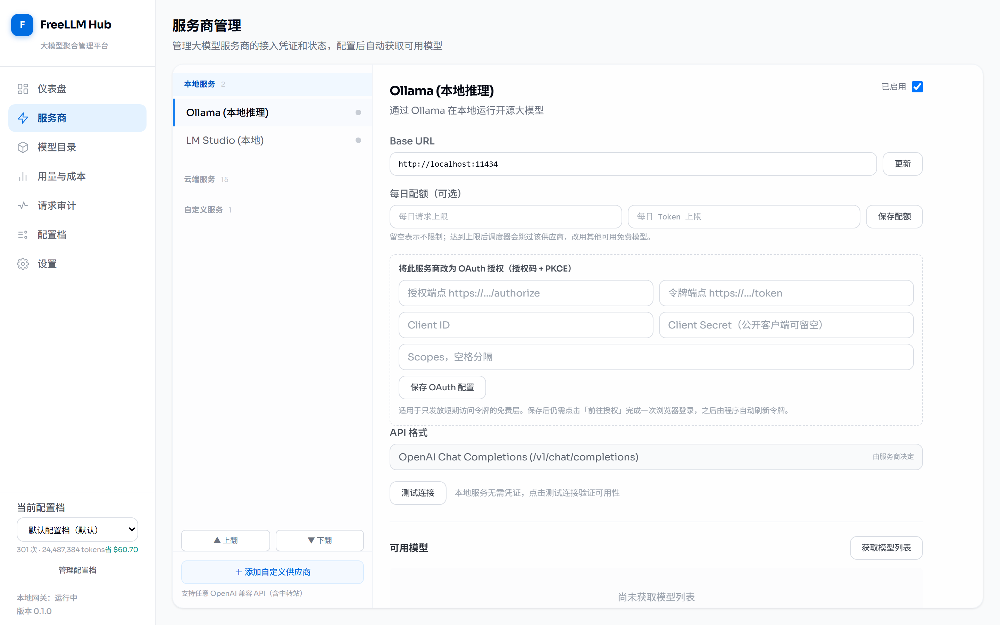
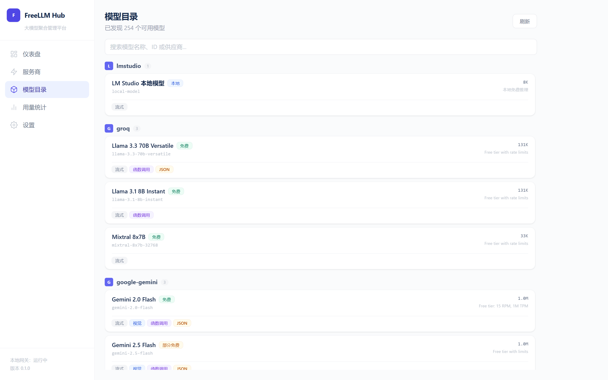
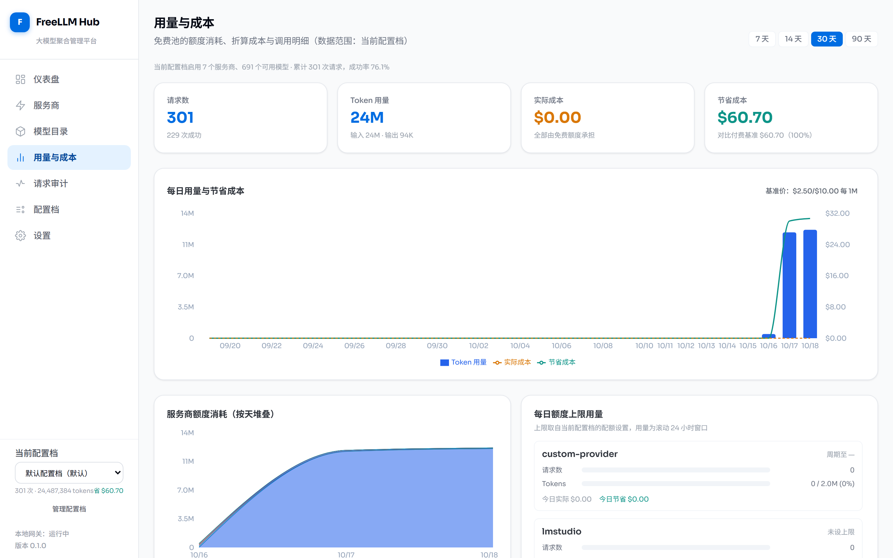
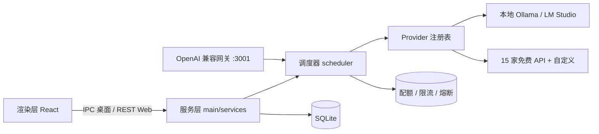

<div align="center">


# FreeLLM Hub

**本地优先的免费大模型聚合平台** —— 统一 API 接入 · 免费额度管理 · 智能调度与故障切换

一个跑在你自己机器上的 AI 推理资源中心：把散落在各家的免费额度收拢成一个 OpenAI 兼容端点，
谁还有额度、谁没被限流、谁最适合这个任务，由调度器替你决定。

[](https://github.com/kedamano/FreeLLM-Hub/actions/workflows/ci.yml)
[](LICENSE)
[](#运行形态)
[](#技术栈)
[](#技术栈)
[](#技术栈)
[](#开发命令)

[快速开始](#快速开始) · [界面预览](#界面预览) · [网关接入](#openai-兼容网关) · [支持的服务商](#支持的服务商) · [架构](#架构) · [文档](#文档)

</div>

---

## 为什么需要它

- **免费额度太分散**：Groq、Gemini、Cloudflare、Hugging Face、Cerebras、SiliconFlow、ModelScope……每家都有一点免费额度，但各有各的 Base URL、各有限流规则。
- **换 Key、换服务商全靠手动**：一个 429 就得自己去看哪家还能用；多把 Key 轮换、熔断、退避都要在客户端重复实现。
- **客户端只认 OpenAI 协议**：编辑器、Agent、SDK 想直连，就必须有人把它们和这堆异构上游对齐。
- **凭证不该离开本机**：API Key 只加密存在本地，不经过任何第三方服务。

FreeLLM Hub 把这些脏活收进一个本地进程：**对外一个端点，对内一组策略**。

## 界面预览

### 仪表盘

总请求数、成功率、Token 消耗与网关接入信息一屏可见。



### 服务商管理

左侧按「本地服务 / 云端服务 / 自定义服务」分组，右侧配置 Base URL、每日配额、多把 API Key 与模型列表。



### 模型目录

自动发现上游模型，按服务商分组，标注免费状态、上下文长度与能力（流式 / 函数调用 / JSON / 视觉）。



### 用量与成本

按服务商 / 模型 / 任务类型聚合的 Token 用量、每日额度消耗条，以及「免费池替你省了多少」的成本曲线
（对比可编辑的付费基准价）。



### 请求审计

网关侧每个请求一行审计记录 + 一条决策轨迹：哪个候选被跳过、为什么（熔断 / 限流 / 超额）、重试了几次、
首字节耗时多少。被令牌校验或参数校验挡在路由之外的流量同样有记录。

## 核心能力

| 能力 | 说明 |
| --- | --- |
| **免费模型聚合** | 内置 17 家服务商（2 个本地 + 15 家提供免费额度的官方 API），并可添加任意 OpenAI 兼容的自定义服务商/中转站 |
| **智能调度** | 按任务类型、模型能力、上下文长度、限流状态、历史成功率与剩余额度打分选模型 |
| **故障切换** | 上游限流或报错时自动改用其他模型；流式响应在**首字节之前**失败同样可切换，不吞掉已输出的内容 |
| **统一 API** | 本地 OpenAI 兼容网关：`/v1/chat/completions`（含流式）、`/v1/models`、`/health` |
| **每日配额** | 按服务商设置每日请求数 / Token 上限，用尽后调度器自动跳过；配额与当日用量落库，**重启不清零** |
| **多密钥轮换** | 每个服务商最多保存 5 把 API Key，命中 429 / 鉴权失败时自动切换下一把 |
| **限流与熔断** | 令牌桶限流（预留—回滚—对账语义）+ 进程内熔断器，重启后给故障服务商一次新的机会 |
| **成本可视化** | 每次调用折算实际成本与付费基准成本，`节省额 = 基准 - 实际`；按天 / 服务商 / 模型 / 任务类型聚合出图，基准价可自定义 |
| **请求审计** | 网关侧 `request_audit` + 决策轨迹表，贯穿同一个 `request_id`（也可复用客户端传来的 `X-Request-Id`），含被拒流量与流式首字节耗时 |
| **多配置档** | 按项目维护各自的免费池：启用哪些服务商、Base URL/参数、每日额度与当日用量互相隔离，一键切换即时生效，未覆盖项继承默认档 |
| **OAuth 服务商** | 授权码 + PKCE、一次性 127.0.0.1 回调端口、令牌到期前主动刷新、401 被动刷新重试，过期与失效状态如实落库并显示在界面上 |
| **用量统计** | 完整调用日志、每日统计、成功率与 Token 估算，并按保留策略自动清理过期记录（调用日志与审计轨迹同步清理） |
| **安全存储** | 凭证经 Electron `safeStorage`（Windows DPAPI）加密落盘，日志与错误消息中不出现明文 |
| **两种运行形态** | Electron 桌面端，或纯 Node 的本地 Web 管理端，二者共用同一套服务层与界面 |

## 快速开始

### 环境要求

| 依赖 | 版本 |
| --- | --- |
| Node.js | 20 LTS 或更高 |
| npm | 10+ |
| 操作系统 | Windows 10/11 64 位、macOS（x64 / Apple Silicon）、Linux（AppImage / deb） |

```bash
npm install
```

### 形态一：本地 Web 管理端（推荐先用这个）

```bash
npm run build
npm run start:web
```

- 管理界面与 REST API：<http://127.0.0.1:3000>
- OpenAI 兼容网关：<http://127.0.0.1:3001/v1>

两个端口都只绑定 `127.0.0.1`，数据落在项目下的 `.web-data/`。
开发时可用 `npm run dev:web`（带热重载）。

想放到局域网里用，需要同时设置 `ADMIN_HOST=0.0.0.0` 与 `ADMIN_TOKEN=<自定义密钥>`——
缺少 `ADMIN_TOKEN` 时管理端会拒绝以非本机地址启动。设置后浏览器需要在「设置 → 管理端令牌」
里填一次该密钥，之后所有管理接口都要带 `Authorization: Bearer`。
供应商密钥的明文只在点击「显示」时按需取回，常规接口一律只给掩码。

### 形态二：Electron 桌面端

```bash
npm run rebuild:electron   # 让 better-sqlite3 对齐 Electron ABI
npm run dev                # Vite 开发服务器 + 桌面窗口

npm run package            # 产出 release/ 下的 portable.exe 与 setup.exe
```

桌面端与 Web 端使用**各自的数据目录**（`.dev-data/` 与 `.web-data/`），凭证需要分别录入。

> `better-sqlite3` 只能对齐一种 ABI：切回 Web 模式前执行 `npm run rebuild:node`，
> 否则会看到 `NODE_MODULE_VERSION` 不匹配的错误。详见[常见问题](#常见问题)。

#### 不用重装、不用换 ABI：给桌面程序加 `--web`

安装好的桌面程序自带同一套管理端与 Web UI，加上 `--web` 即以无窗口方式运行：

```bash
# Windows
"FreeLLM Hub.exe" --web
# macOS
"./FreeLLM Hub.app/Contents/MacOS/FreeLLM Hub" --web
# Linux（AppImage 解包后同理）
./freellm-hub --web
```

它复用当前进程的 Electron ABI，数据目录也与桌面窗口模式**完全相同**（同一个
`userData/data/freellm-hub.db`，同一份凭证），所以不需要 `npm run rebuild:node`，
也不需要重新录入密钥。管理端与网关地址仍是 `127.0.0.1:3000` / `127.0.0.1:3001`，
`ADMIN_HOST`、`ADMIN_PORT`、`GATEWAY_PORT`、`ADMIN_TOKEN` 等环境变量照常可用。

桌面窗口与 `--web` 共用单实例锁（两者会抢同一份数据库和端口），因此不能同时运行；
后启动的那个会直接报错退出。Windows 上打包后的程序是 GUI 子系统进程，日志默认不进终端，
需要看启动输出时设置 `ELECTRON_ENABLE_LOGGING=1`。

### 接入你的客户端

在任意支持自定义 OpenAI 地址的客户端（zcode、Continue、各类 SDK）里填：

```bash
OPENAI_BASE_URL=http://127.0.0.1:3001/v1
OPENAI_API_KEY=<设置页里的网关令牌>
```

网关令牌可在「设置」页查看或重新生成；也可以关闭鉴权，仅在本机使用。

## OpenAI 兼容网关

非流式：

```bash
curl http://127.0.0.1:3001/v1/chat/completions \
  -H "Content-Type: application/json" \
  -H "Authorization: Bearer <网关令牌>" \
  -d '{
    "model": "auto",
    "task_type": "coding",
    "messages": [{ "role": "user", "content": "用 Go 写一个 LRU 缓存" }]
  }'
```

- **`model` 可以乱填**：留空、填 `auto` 或填一个本地没有的模型名，调度器都会从可用免费池里挑一个真正能跑的模型。
- **`task_type`** 支持 `general` `coding` `analysis` `creative` `summarization` `classification` `extraction` `translation` `lightweight`，未提供时使用「设置」里的默认任务类型。
- 流式请求把 `"stream": true` 加上即可，返回标准 SSE。

错误语义与 OpenAI 客户端生态对齐，便于上游直接判断是否重试：

| HTTP | code | 含义 |
| --- | --- | --- |
| 429 | `RATE_LIMITED` | 上游限流，响应带 `Retry-After` |
| 429 | `QUOTA_EXCEEDED` | 当日配额用尽，`Retry-After` 为距次日重置的秒数 |
| 401 | `AUTH_FAILED` | 上游凭证无效 |
| 404 | `MODEL_NOT_FOUND` | 没有任何模型能满足该请求 |
| 400 | `BAD_REQUEST` | 请求体不合法 |
| 503 | `CIRCUIT_OPEN` / `ALL_FAILED` | 候选服务商全部熔断或全部失败 |
| 504 | `TIMEOUT` | 上游超时 |

完整请求/响应格式与 IPC、REST 通道清单见 [docs/api-reference.md](docs/api-reference.md)。

## 支持的服务商

| 服务商 | 类型 | 认证 | 备注 |
| --- | --- | --- | --- |
| Ollama | 本地 | 无需认证 | Base URL 可改，默认 `http://localhost:11434` |
| LM Studio | 本地 | 无需认证 | 本地 OpenAI 兼容服务 |
| Groq | 云端免费 | API Key | 30 RPM / 100K TPM |
| Google Gemini | 云端免费 | API Key | 15 RPM / 1M TPM |
| Cloudflare Workers AI | 云端免费 | API Token + Account ID | Account ID 可在服务商配置里填写 |
| Hugging Face | 云端免费 | Token | 200 RPM 量级 |
| Cerebras | 云端免费 | API Key | 免费层级 |
| SiliconFlow / NVIDIA NIM / OpenRouter / ModelScope / SenseNova / LongCat / 智谱 / Moonshot / DeepSeek / MiniMax | 云端免费 | API Key | 额度以各家官方页面为准 |
| 自定义服务商 | 云端 | API Key + Base URL | 任意 OpenAI 兼容端点（含中转站），后端持久化 |

每家都可设每日请求 / Token 配额（留空或 0 表示不限制），并保存最多 5 把 Key。

## 架构



一次请求的路径：**网关校验 → 解析任务类型 → 调度器按能力与额度打分排序 → 逐个尝试（限流预留、失败回滚、必要时切换模型）→ 记录用量**。
桌面端与 Web 端走的是同一套服务层，区别只在传输方式（`ipcMain.handle` 还是 Fastify 路由）。

### 目录结构

```
src/
├── main/           # Electron 主进程
│   ├── gateway/    # OpenAI 兼容网关 (Fastify)
│   ├── ipc/        # IPC 通信处理器
│   ├── security/   # 安全模块
│   └── services/   # 业务服务层（IPC 与 REST 共用）
├── server/         # 独立 Web 进程：Admin REST API + 渲染产物静态服务
├── preload/        # Electron 预加载脚本
├── renderer/       # React 前端界面
│   └── src/
│       ├── pages/  # 页面组件
│       ├── hooks/  # 数据获取（IPC / HTTP 双实现）
│       └── components/ # 公共组件
├── core/           # 核心逻辑层
│   ├── config/     # 应用配置
│   ├── database/   # SQLite 数据层
│   ├── providers/  # Provider 适配器与注册表
│   └── settings/   # 设置存储
├── scheduler/      # 智能调度器（候选过滤、评分、熔断、限流、配额）
├── usage/          # 调用账本、成本台账、请求审计、Token 估算、日志保留
└── shared/         # 共享类型、错误、IPC 通道契约、工具
```

## 技术栈

| 层 | 选型 |
| --- | --- |
| 桌面 | Electron 33 + Vite 6 + TypeScript 5.7 |
| 前端 | React 18 + React Router 6 + Tailwind CSS 3.4 |
| 本地服务 | Fastify 5 + better-sqlite3 |
| 打包 | electron-builder（Windows portable + NSIS，输出 `release/`） |
| 测试 | Vitest（单元 / 集成 / 组件）+ Playwright（E2E） |
| 质量 | ESLint 9 (flat config) + Prettier + `tsc --noEmit` |

## 开发命令

| 命令 | 作用 |
| --- | --- |
| `npm run dev` | Vite 开发服务器 + Electron 窗口 |
| `npm run dev:web` | 仅本地 Web 服务（热重载） |
| `npm run start:web` | 以生产构建运行 Web 服务（需先 `npm run build`） |
| `npm run build` | 构建主进程与渲染进程到 `dist/` |
| `npm run package` | 按当前操作系统打包到 `release/` |
| `npm run package:win` / `package:mac` / `package:linux` | 指定平台打包（macOS 产物必须在 macOS 上构建） |
| `npm run package:all` / `package:dir` | 全平台打包 / 仅解包目录（调试用） |
| `npm test` | Vitest 全量测试 |
| `npm run typecheck` | 主进程与渲染进程类型检查 |
| `npm run lint` | ESLint（`src/` 与 `scripts/`） |
| `npm run format` | Prettier 格式化 |
| `npm run test:e2e` | Playwright E2E（需先 build 并启动 Web 服务） |
| `npm run gen:icons` | 重新生成 `resources/icons/` 下的图标资源 |
| `npm run rebuild:node` / `rebuild:electron` | 切换 `better-sqlite3` 的 ABI |

提交前请确保 `npm test`、`npm run typecheck`、`npm run lint` 均通过，CI 会在 Windows 与 Linux 矩阵上执行同样的检查；
推送到 `main` 时还会在 Windows / Linux(x64、arm64) / macOS 上各自产出安装包并上传为构建产物，
详见 [docs/release-checklist.md](docs/release-checklist.md)。

## 常见问题

**启动报 `NODE_MODULE_VERSION` 不匹配**
`better-sqlite3` 是原生模块，桌面端与纯 Node 需要不同 ABI：跑 Web 用 `npm run rebuild:node`，跑桌面用 `npm run rebuild:electron`。

**端口 3000 / 3001 被占用**
多为上一次未退干净的 Node 进程：`netstat -ano | findstr :3000` 找到 PID 后结束它。

**打包时报符号链接权限错误**
electron-builder 解包签名工具链需要创建符号链接，普通权限的终端会失败；用管理员终端或开启 Windows「开发者模式」，详见 [docs/release-checklist.md](docs/release-checklist.md)。

**上游一直 429**
先看「用量与成本」页的额度消耗条确认是否当日配额用尽，再看「服务商」页的剩余额度；仍不清楚就打开「请求审计」，
该请求的候选跳过原因与重试轨迹都在里面。更多见 [docs/troubleshooting.md](docs/troubleshooting.md)。

## 文档

| 文档 | 内容 |
| --- | --- |
| [docs/architecture.md](docs/architecture.md) | 模块划分、双运行形态、数据落盘 |
| [docs/api-reference.md](docs/api-reference.md) | 网关 API、Web REST、IPC 通道 |
| [docs/scheduler.md](docs/scheduler.md) | 评分与路由、限流、配额、熔断、错误语义 |
| [docs/security.md](docs/security.md) | 凭证存储、进程隔离、IPC 白名单 |
| [docs/provider-development.md](docs/provider-development.md) | 如何新增一个服务商适配器 |
| [docs/release-checklist.md](docs/release-checklist.md) | 发布前检查与打包注意事项 |
| [docs/troubleshooting.md](docs/troubleshooting.md) | 常见问题排查 |

## 安全说明

- 凭证通过 Electron `safeStorage`（Windows DPAPI）加密存储，仅当前用户可解密；Web 模式使用独立数据目录。
- 渲染进程启用 `contextIsolation`、关闭 `nodeIntegration`、开启 `sandbox`，并通过 [docs/security.md](docs/security.md) 描述的导航守卫限制外跳。
- 所有 IPC 通道走白名单校验，输入在入口用 schema 收敛。
- 网关与管理端默认只监听 `127.0.0.1`，不对外网暴露。
- 日志、错误消息与前端输出中不会出现明文凭证。

## Roadmap

已完成（本仓库当前分支）：

- [x] macOS / Linux 打包与 CI 产物发布（`dmg`/`zip`、`AppImage`/`deb`/`tar.gz`、三平台矩阵 + `upload-artifact`）
- [x] 服务商额度用量的成本可视化（成本台账 + recharts 趋势图 + 额度消耗条）
- [x] OAuth 类服务商与自动刷新凭证（授权码 + PKCE 框架，自定义服务商可直接接入）
- [x] 多配置档（不同项目切换不同免费池）
- [x] 网关侧的请求审计与可观测性面板

下一步：

- [ ] 为具体免费服务商内置 OAuth 规格（client_id 申请与文档化）
- [ ] macOS 公证（notarization）与 Windows 代码签名流水线
- [ ] 审计轨迹的按天预聚合与导出（CSV / JSONL）

## 贡献

1. Fork 本仓库并新建分支（`feat/xxx`、`fix/xxx`）。
2. 改动行为请同时补测试：单元测试放 `tests/unit/`，网关与 REST 集成测试放 `tests/integration/`，组件测试放 `tests/components/`。
3. 提交前运行 `npm run typecheck && npm run lint && npm test`。
4. 开 PR 时说明动机与影响面，关联对应 issue。

## License

[MIT](LICENSE) © 2026 FreeLLM Hub Team
