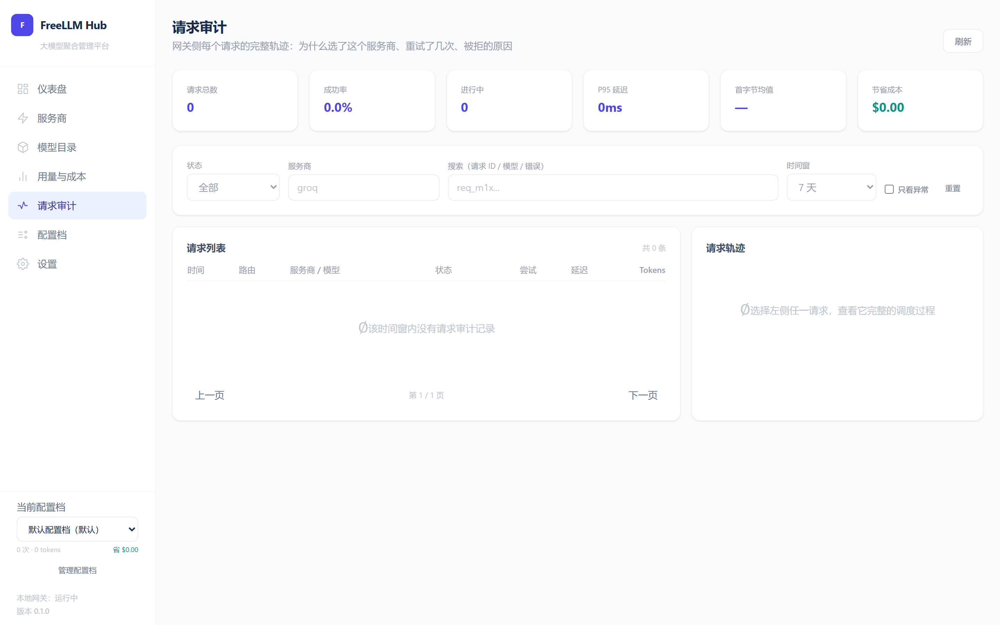
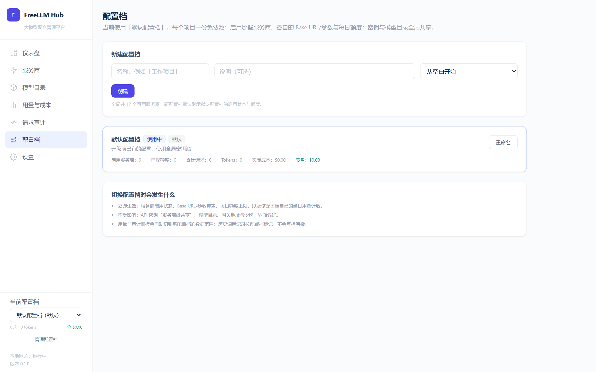
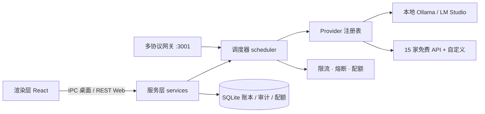

<div align="center">


# FreeLLM Hub

### 把散落各家的免费大模型额度，收成一个 OpenAI 兼容端点

一个跑在你自己机器上的 AI 推理资源中心：谁还有额度、谁没被限流、谁最适合这个任务，
由本地调度器替你决定 —— 多密钥轮换、每日配额、熔断退避、故障切换、成本台账，全都不出本机。

[](https://github.com/kedamano/FreeLLM-Hub/actions/workflows/ci.yml)
[](https://github.com/kedamano/FreeLLM-Hub/releases/latest)
[](LICENSE)
[](#-快速开始)
[](https://github.com/kedamano/FreeLLM-Hub/commits/main)

**[📥 下载发行版](https://github.com/kedamano/FreeLLM-Hub/releases/latest)** ·
**[⚡ 快速开始](#-快速开始)** ·
**[🖼️ 界面一览](#-界面一览)** ·
**[🧩 支持的服务商](#-支持的服务商)** ·
**[📚 文档](#-文档)**

</div>

<br />

<div align="center">
  
  <br/>
  <sub>仪表盘：一屏看清请求量、成功率、Token 消耗与网关接入信息</sub>
</div>

<br />

<details open>
<summary><b>📑 目录</b></summary>

- [为什么需要它](#为什么需要它)
- [快速开始](#-快速开始)
- [核心特性](#-核心特性)
- [界面一览](#-界面一览)
- [接入你的客户端](#-接入你的客户端)
- [支持的服务商](#-支持的服务商)
- [架构](#-架构)
- [运行形态](#运行形态)
- [开发](#-开发)
- [文档](#-文档)
- [贡献](#-贡献)

</details>

---

## 为什么需要它

你大概已经攒了一堆免费额度 —— Groq、Gemini、Cloudflare、Hugging Face、Cerebras、SiliconFlow、智谱、Moonshot…… 但真实体验是：

| 痛点 | 现状 | FreeLLM Hub |
| --- | --- | --- |
| 额度分散 | 每家一个 Base URL、一套限流规则，来回切 | **一个端点**统一对外 |
| 换 Key / 换服务商全靠手动 | 一个 429 就得自己找哪家还能用 | 多 Key 轮换 + 熔断 + **自动故障切换** |
| 客户端只认 OpenAI 协议 | 编辑器 / Agent / SDK 得逐个适配异构上游 | 本地对齐，客户端**零改动** |
| 不知道花了多少、省了多少 | 各家控制台各说各话 | **成本台账**：按天/服务商/模型折算节省额 |
| 排查全靠猜 | 为什么这次走了 Cerebras？ | **请求审计**：每个请求的完整决策轨迹 |
| 凭证安全 | 明文躺在 `.env` 里 | 仅 `safeStorage` 加密落本机，日志全脱敏 |

> 一句话：**对外一个端点，对内一组策略。** 脏活收进一个本地进程，密钥永不离开你的机器。

---

## ⚡ 快速开始

### 方式一 · 下载即用（推荐先试这个）

到 [Releases](https://github.com/kedamano/FreeLLM-Hub/releases/latest) 下载对应平台的安装包，双击运行：

| 平台 | 产物 |
| --- | --- |
| **Windows** | `FreeLLM Hub-*-setup.exe`（NSIS）或 `-portable.exe`（免安装） |
| **macOS** | `FreeLLM Hub-*-x64.dmg` / `-arm64.dmg`（Intel / Apple Silicon） |
| **Linux** | `FreeLLM Hub-*-x86_64.AppImage` / `_amd64.deb` / `-x86_64.tar.gz` |

打开后进入「服务商」页，粘贴任意一家的 API Key → 复制网关地址 → 填进你的客户端，完成。

### 方式二 · 从源码运行

```bash
git clone https://github.com/kedamano/FreeLLM-Hub.git
cd FreeLLM-Hub
npm install
npm run build && npm run start:web
```

- 管理界面：<http://127.0.0.1:3000>
- OpenAI 兼容网关：<http://127.0.0.1:3001/v1>

两个端口默认只绑定 `127.0.0.1`。开发热重载用 `npm run dev:web`。

---

## ✨ 核心特性

| | 能力 | 说明 |
| :---: | --- | --- |
| 🧠 | **智能调度** | 按任务类型、模型能力、上下文长度、限流状态、历史成功率与剩余额度打分选模型 |
| 🔀 | **故障切换** | 上游限流/报错自动改用其他模型；流式响应在**首字节之前**失败同样可切换，不吞已输出内容 |
| 🔑 | **多密钥轮换** | 每家最多存 5 把 Key，命中 429 / 鉴权失败自动切下一把 |
| 📊 | **每日配额** | 按服务商设请求/Token 上限，用尽自动跳过；配额与当日用量落库，**重启不清零** |
| 🛡️ | **限流与熔断** | 令牌桶（预留—回滚—对账）+ 进程内熔断器，重启给故障服务商新机会 |
| 💰 | **成本可视化** | 每次调用折算实际/基准成本，`节省 = 基准 − 实际`；趋势图 + 额度消耗条，基准价可自定义 |
| 🔍 | **请求审计** | `request_id` 贯穿日志/账本/审计表，含被拒流量与流式首字节耗时；面板可筛选、分页、看轨迹 |
| 🗂️ | **多配置档** | 按项目维护各自免费池（启用/参数/配额/用量互相隔离），一键切换即时生效 |
| 🔐 | **OAuth 服务商** | 授权码 + PKCE、一次性 127.0.0.1 回调、到期主动刷新、401 被动重试，过期状态如实落库 |
| 🌐 | **多协议网关** | OpenAI Chat Completions / Embeddings / Models + **Anthropic Messages**（Claude Code 直连） |
| 💻 | **双运行形态** | Electron 桌面端，或纯 Node 本地 Web 管理端，共用同一套服务层与界面 |
| 🔒 | **本地安全** | `safeStorage` 加密、`contextIsolation` + `sandbox`、IPC 白名单、日志脱敏 |

---

## 🖼️ 界面一览

<table>
  <tr>
    <td width="50%"><br/><sub><b>服务商管理</b>：分组配置 Base URL、每日配额、多把 Key 与模型发现</sub></td>
    <td width="50%"><br/><sub><b>模型目录</b>：自动发现上游模型，标注免费状态、上下文与能力</sub></td>
  </tr>
  <tr>
    <td><br/><sub><b>用量与成本</b>：Token 趋势、额度消耗条、免费池节省成本曲线</sub></td>
    <td><br/><sub><b>请求审计</b>：每个请求的候选跳过原因、重试轨迹、首字节耗时</sub></td>
  </tr>
  <tr>
    <td colspan="2"><br/><sub><b>配置档</b>：为不同项目准备不同的免费池，一键切换</sub></td>
  </tr>
</table>

---

## 🔌 接入你的客户端

任意支持自定义 OpenAI 地址的客户端（Claude Code、Codex、Continue、Cherry Studio、各类 SDK）里填：

```bash
OPENAI_BASE_URL=http://127.0.0.1:3001/v1
OPENAI_API_KEY=<设置页里的网关令牌>
```

一次调用，看调度器怎么选模型：

```bash
curl http://127.0.0.1:3001/v1/chat/completions \
  -H "Content-Type: application/json" \
  -H "Authorization: Bearer <网关令牌>" \
  -d '{
    "model": "auto",
    "task_type": "coding",
    "messages": [{ "role": "user", "content": "用 Go 写一个 LRU 缓存" }]
  }'
```

- **`model` 可以乱填**：留空、`auto` 或一个本地没有的名字，调度器都会从可用免费池里挑一个真正能跑的。
- **`task_type`** 支持 `general` `coding` `analysis` `creative` `summarization` `classification` `extraction` `translation` `lightweight`。
- 加 `"stream": true` 即返回标准 SSE；首帧之前的失败以真实状态码 + JSON 错误体返回，绝不伪装成 `200`。
- 错误语义与 OpenAI 生态对齐（`429 RATE_LIMITED` / `429 QUOTA_EXCEEDED` / `404 MODEL_NOT_FOUND` / `503 CIRCUIT_OPEN` / `504 TIMEOUT` …），客户端可直接判断是否重试。

Claude Code 走原生 Anthropic 协议接入、Codex 走 OpenAI Chat 接入，具体配置见 **[docs/client-setup.md](docs/client-setup.md)**。

---

## 🧩 支持的服务商

内置 **17 家**（2 个本地 + 15 家提供免费额度的官方 API），外加任意 OpenAI 兼容的自定义服务商 / 中转站。

| 本地 | 云端免费（API Key / Token） |
| --- | --- |
| Ollama · LM Studio | Groq · Google Gemini · Cloudflare Workers AI · Hugging Face · Cerebras · SiliconFlow · NVIDIA NIM · OpenRouter · ModelScope · SenseNova · LongCat · 智谱 · Moonshot · DeepSeek · MiniMax |

每家都可设每日请求 / Token 配额（留空或 0 表示不限），并保存最多 5 把 Key。额度以各家官方页面为准。
新增一家只需在声明式目录里加一条 seed，无需写适配器代码 —— 见 [docs/provider-development.md](docs/provider-development.md)。

---

## 🏗️ 架构



一次请求：**网关校验 → 解析任务类型 → 调度器按能力与额度打分排序 → 逐个尝试（限流预留、失败回滚、必要时切换模型）→ 记录用量与审计**。桌面端与 Web 端共用同一套服务层，区别只在传输方式（`ipcMain.handle` 还是 Fastify 路由）。

---

## 运行形态

| 形态 | 启动 | 数据目录 | 适用 |
| --- | --- | --- | --- |
| **Electron 桌面** | `npm run dev` / 发行版安装包 | `userData/`（如 `%APPDATA%/FreeLLM Hub`） | 日常本机使用 |
| **本地 Web** | `npm run build && npm run start:web` | 项目下 `.web-data/` | 服务器 / 无桌面环境 |
| **桌面程序加 `--web`** | `FreeLLM Hub --web` | 与桌面窗口**同一份**数据 | 已装桌面版、想要 HTTP 接口 |

<details>
<summary><b>局域网访问 · ABI 切换 · 常见坑</b>（点击展开）</summary>

- **放到局域网**：同时设 `ADMIN_HOST=0.0.0.0` 与 `ADMIN_TOKEN=<自定义密钥>`；缺 `ADMIN_TOKEN` 时管理端拒绝以非本机地址启动。设置后浏览器需在「设置 → 管理端令牌」填一次该密钥，之后管理接口都要带 `Authorization: Bearer`。
- **ABI 切换**：`better-sqlite3` 是原生模块，桌面端与纯 Node 需要不同 ABI。跑 Web 用 `npm run rebuild:node`，跑桌面用 `npm run rebuild:electron`；已安装的桌面程序加 `--web` 复用当前 ABI，**无需重装或换 ABI**。
- **端口被占**：多为上次未退净的进程，`netstat -ano | findstr :3000` 找到 PID 结束它。
- **打包符号链接权限**：electron-builder 解包签名工具链需创建符号链接，普通终端可能失败；用管理员终端或开启 Windows「开发者模式」。

完整排查见 [docs/troubleshooting.md](docs/troubleshooting.md)。
</details>

---

## 🛠️ 开发

```bash
npm run dev          # Vite + Electron 桌面窗口
npm run dev:web      # 仅本地 Web（热重载）
npm test             # Vitest 全量（单元 / 集成 / 组件，700+ 用例）
npm run test:e2e     # Playwright 端到端
npm run typecheck    # 主进程 + 渲染进程类型检查
npm run lint         # ESLint
npm run build        # 构建到 dist/
npm run package      # 按当前平台打包到 release/（另有 :win/:mac/:linux/:all）
```

技术栈：Electron 33 · Vite 6 · React 18 · TypeScript 5.7 · Tailwind 3.4 · Fastify 5 · better-sqlite3 · electron-builder。
CI 在 Windows / Linux 矩阵跑同样的检查，推送到 `main` 时三平台各自产出安装包并上传为构建产物；打 `v*` 标签自动发布 GitHub Release（含 electron-updater 更新清单）。

---

## 📚 文档

| 文档 | 内容 |
| --- | --- |
| [docs/client-setup.md](docs/client-setup.md) | **Claude Code / Codex 接入指引** |
| [docs/architecture.md](docs/architecture.md) | 模块划分、双运行形态、数据落盘、配置档模型 |
| [docs/api-reference.md](docs/api-reference.md) | 网关 API（OpenAI + Anthropic）、Web REST、IPC 通道 |
| [docs/scheduler.md](docs/scheduler.md) | 评分与路由、限流、配额、熔断、调度轨迹 |
| [docs/security.md](docs/security.md) | 凭证存储、OAuth 令牌托管、审计数据最小化、进程隔离 |
| [docs/provider-development.md](docs/provider-development.md) | 如何新增一个服务商（声明式 seed / OAuth） |
| [docs/release-checklist.md](docs/release-checklist.md) | 发布前检查与三平台打包注意事项 |
| [docs/troubleshooting.md](docs/troubleshooting.md) | 常见问题排查 |

---

## 🤝 贡献

欢迎贡献！Fork 后新建分支（`feat/xxx`、`fix/xxx`），改动行为请同步补测试（`tests/unit`、`tests/integration`、`tests/components`），提交前跑 `npm run typecheck && npm run lint && npm test`。开 PR 时说明动机与影响面。

不确定从哪开始？看看标了 `good first issue` 的 [Issues](https://github.com/kedamano/FreeLLM-Hub/issues)。

---

<div align="center">

如果这个项目帮你省下了折腾上游的时间，点个 **⭐ Star** 是最好的支持。

**[MIT](LICENSE)** © 2026 FreeLLM Hub Team

</div>
